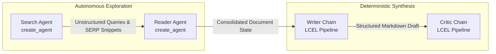
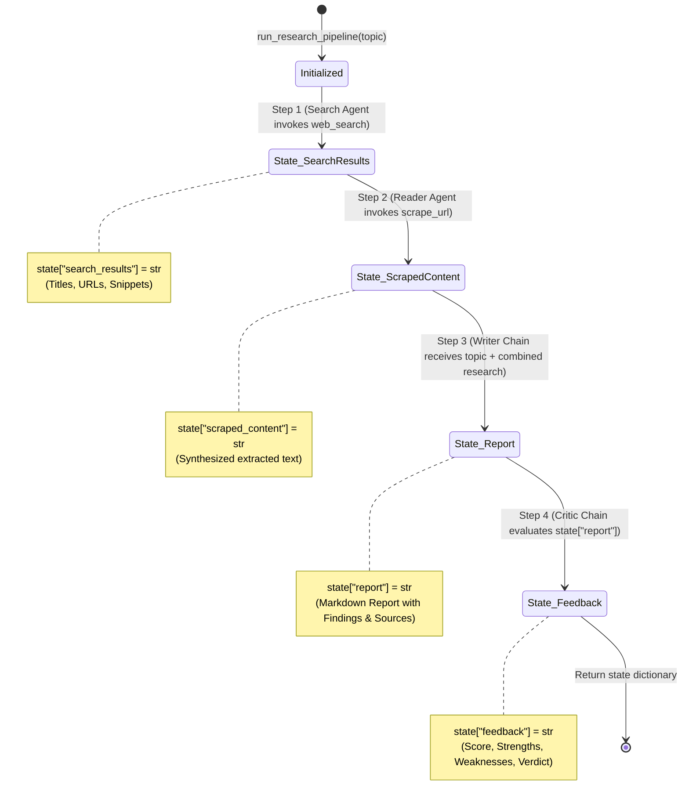
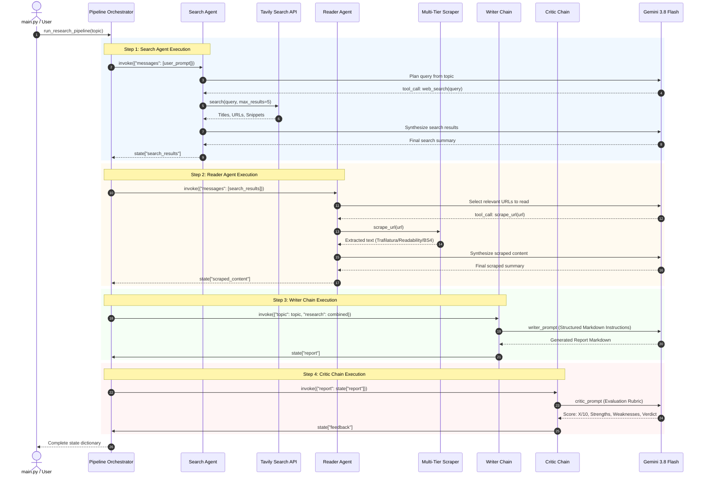
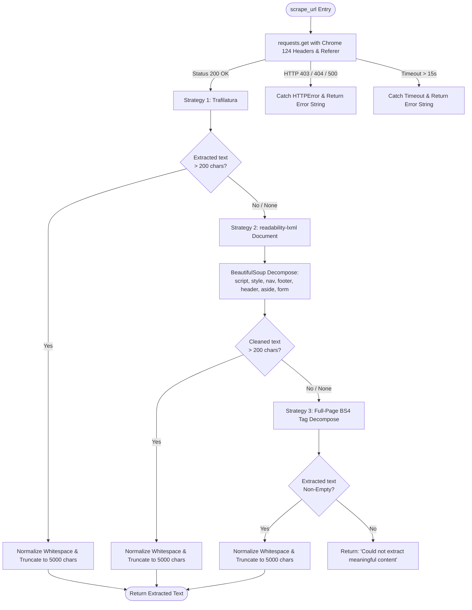

# System Architecture & Technical Design

This document details the software architecture, design principles, data flow, and agent orchestration mechanisms of the **Multi-Agent Research System**.

---

## 1. Architectural Philosophy: Agents vs. Chains

A central design decision of this system is the deliberate split between **dynamic autonomous agents** and **deterministic sequential chains**.



### Why Not Use All Agents?
Autonomous ReAct (Reasoning + Acting) agents excel when the exact sequence of actions is unknown in advance. For example, a search engine query may require reformulation, or the model may need to inspect multiple URLs depending on the quality of intermediate snippets. 

However, agents introduce non-determinism, higher latency, and token overhead when applied to purely generative or evaluative tasks. Running a writer or critic as an autonomous tool-using agent risks tool-calling hallucinations, unnecessary reasoning loops, and formatting degradation.

### Why Not Use All Chains?
Chains (LangChain Expression Language - LCEL) are deterministic Directed Acyclic Graphs (DAGs). They execute in a single forward pass:
$$\text{Input} \longrightarrow \text{PromptTemplate} \longrightarrow \text{LLM} \longrightarrow \text{OutputParser}$$

Chains cannot dynamically decide whether external information is required, nor can they handle runtime tool execution errors or retry failed web requests.

### The Hybrid Compromise
| Pipeline Component | Paradigm | Rationale |
| :--- | :--- | :--- |
| **Search Agent** | ReAct Agent (`create_agent`) | Dynamically formulates web search queries via Tavily based on the research topic. |
| **Reader Agent** | ReAct Agent (`create_agent`) | Inspects search results, decides which URLs to scrape via `scrape_url`, and synthesizes raw HTML extractions. |
| **Writer Chain** | LCEL Chain (`Prompt \| LLM \| Parser`) | Deterministically consolidates all research state into a standardized, multi-section report. |
| **Critic Chain** | LCEL Chain (`Prompt \| LLM \| Parser`) | Deterministically evaluates the generated draft against strict editorial criteria, producing a score ($X/10$) and structured feedback. |

---

## 2. Shared State Architecture

The pipeline orchestrator manages communication across stages using an explicit in-memory state dictionary (`state: dict`). Rather than relying on hidden global variables or complex thread contexts, state transitions are passed sequentially through [`run_research_pipeline`](file:///c:/Users/sanja/Desktop/agentic%20ai/Langchain-Multi-Agent-Research-System/src/pipelines/pipeline.py).

### Pipeline State Lifecycle



### State Schema Breakdown
```python
state = {
    # Populated in Step 1 by Search Agent
    "search_results": str,  # Raw SERP titles, URLs, and snippets retrieved from Tavily
    
    # Populated in Step 2 by Reader Agent
    "scraped_content": str, # Deep content extracted from selected URLs via Trafilatura/Readability
    
    # Populated in Step 3 by Writer Chain
    "report": str,          # Structured Markdown document (Intro, Key Findings, Conclusion, Sources)
    
    # Populated in Step 4 by Critic Chain
    "feedback": str         # Formatted critique (Score: X/10, Strengths, Areas to Improve, Verdict)
}
```

---

## 3. End-to-End Execution Sequence

The sequence diagram below illustrates the exact interactions between the Python pipeline runner, Google Gemini 3.8 Flash, external tools (Tavily & Requests), and the shared state:



---

## 4. Stage-by-Stage Component Specifications

### 4.1 Search Agent
- **Factory Function**: [`build_search_agent()`](file:///c:/Users/sanja/Desktop/agentic%20ai/Langchain-Multi-Agent-Research-System/src/agents/agents.py#L22-L27)
- **Engine**: LangChain `create_agent` ReAct loop with `gemini-3.8-flash`.
- **Tools Bound**: `[web_search]`
- **Behavior**: The agent receives the research topic and autonomously formulates one or more search queries. It calls Tavily, extracts the top 5 organic search results, and returns structured titles, snippets, and source URLs.

```python
def build_search_agent():
    return create_agent(
        model=llm,
        tools=[web_search],
    )
```

### 4.2 Reader Agent
- **Factory Function**: [`build_reader_agent()`](file:///c:/Users/sanja/Desktop/agentic%20ai/Langchain-Multi-Agent-Research-System/src/agents/agents.py#L31-L36)
- **Engine**: LangChain `create_agent` ReAct loop with `gemini-3.8-flash`.
- **Tools Bound**: `[scrape_url]`
- **Behavior**: The agent inspects the search results generated in Step 1. It identifies which external URLs are likely to contain substantive data, calls `scrape_url(url)`, and produces a consolidated informational summary.

### 4.3 Writer Chain
- **Definition**: [`writer_chain = writer_prompt | llm | StrOutputParser()`](file:///c:/Users/sanja/Desktop/agentic%20ai/Langchain-Multi-Agent-Research-System/src/agents/agents.py#L40-L58)
- **Paradigm**: LCEL deterministic chain.
- **Prompt Structure**:
  - `system`: Assigns the persona of an expert research writer.
  - `human`: Injects `{topic}` and `{research}` (combining search snippets and scraped full-text).
  - Explicit section constraints: Introduction, Key Findings (minimum 3 well-explained points), Conclusion, Sources.
- **Output Parser**: `StrOutputParser` extracts the raw string response from the Gemini `AIMessage`.

### 4.4 Critic Chain
- **Definition**: [`critic_chain = critic_prompt | llm | StrOutputParser()`](file:///c:/Users/sanja/Desktop/agentic%20ai/Langchain-Multi-Agent-Research-System/src/agents/agents.py#L61-L84)
- **Paradigm**: LCEL deterministic chain.
- **Prompt Structure**:
  - `system`: Assigns the persona of an objective, constructive research critic.
  - `human`: Injects `{report}` and enforces a strict evaluation template:
    - `Score: X/10`
    - `Strengths:` (bulleted)
    - `Areas to Improve:` (bulleted)
    - `One Line Verdict:` (concise summary)

---

## 5. Tool Integration & The 3-Tier Scraper Architecture

The scraping subsystem in [`src/tools/tools.py`](file:///c:/Users/sanja/Desktop/agentic%20ai/Langchain-Multi-Agent-Research-System/src/tools/tools.py) implements a 3-tier heuristic cascade designed to balance extraction precision against website variability.



### Extraction Strategy Matrix

| Strategy | Library | Target Use-Case | Strengths | Weaknesses |
| :--- | :--- | :--- | :--- | :--- |
| **Tier 1** | `trafilatura` | News articles, press releases, blog posts | Heuristic body identification, eliminates boilerplate, strips ads | Fails on sparse DOMs and client-side rendered apps |
| **Tier 2** | `readability-lxml` + `bs4` | Generic article pages with non-standard wrappers | Fast summary extraction based on arc90 algorithm | Requires manual tag sanitization |
| **Tier 3** | `BeautifulSoup4` (raw) | Non-editorial websites, documentation, simple landing pages | Captures all visible text when heuristics fail | High noise-to-signal ratio (may include navigation/sidebar leftovers) |

### Context Window Protection
To prevent unconstrained HTML documents from overflowing Gemini's context window or causing excessive latency, all extraction paths enforce:
1. **Length Validation**: Text must exceed 200 characters to be considered valid content.
2. **Hard Truncation**: Text is truncated at 5,000 characters (`return cleaned[:5000]`).
3. **Whitespace Normalization**: Regex substitution `re.sub(r'\s+', ' ', text)` reduces token consumption from redundant newlines and tabs.

---

## 6. Fault Tolerance & Exception Boundaries

A critical requirement in multi-agent pipelines is preventing tool-level failures from crashing the orchestration loop.

### Safe Tool Returns
In [`src/tools/tools.py`](file:///c:/Users/sanja/Desktop/agentic%20ai/Langchain-Multi-Agent-Research-System/src/tools/tools.py), the `scrape_url` tool wraps all network operations in explicit try/except blocks:

```python
try:
    response = requests.get(url, headers=headers, timeout=15)
    response.raise_for_status()
    ...
except requests.exceptions.Timeout:
    return "Request timed out while scraping the URL."
except requests.exceptions.HTTPError as e:
    return f"HTTP error occurred: {str(e)}"
except Exception as e:
    return f"Could not scrape URL: {str(e)}"
```

### Why Return Strings Instead of Raising?
If `scrape_url` raised an unhandled `requests.exceptions.HTTPError` on an HTTP 403 Forbidden, the entire Python process would terminate, destroying the intermediate research state.

By returning an error string, the message is serialized into the LangChain `ToolMessage`. The ReAct agent receives this message as an observation, learns that the specific URL is inaccessible, and can choose to proceed with other available sources or synthesize findings from search snippets alone.

---

## 7. Python Modular Architecture & Import Structure

The project adheres to standard Python package structuring principles:

```
src/
├── __init__.py          # Package root
├── tools/
│   ├── __init__.py      # Subpackage marker
│   └── tools.py         # Pure tool definitions (@tool)
├── agents/
│   ├── __init__.py      # Subpackage marker
│   └── agents.py        # Model initialization, agent factories & LCEL chains
└── pipelines/
    ├── __init__.py      # Subpackage marker
    └── pipeline.py      # Pipeline runner & state machine
```

### Key Architectural Rules
1. **No Circular Dependencies**: `tools.py` has no dependency on `agents.py` or `pipeline.py`. `agents.py` imports only tools. `pipeline.py` imports agents and chains.
2. **Absolute Module Imports**: All cross-module imports use the package namespace (e.g., `from src.tools.tools import web_search`).
3. **Decoupled Execution Entrypoint**: `main.py` serves strictly as an invocation script, keeping orchestration logic isolated within `src.pipelines`.

