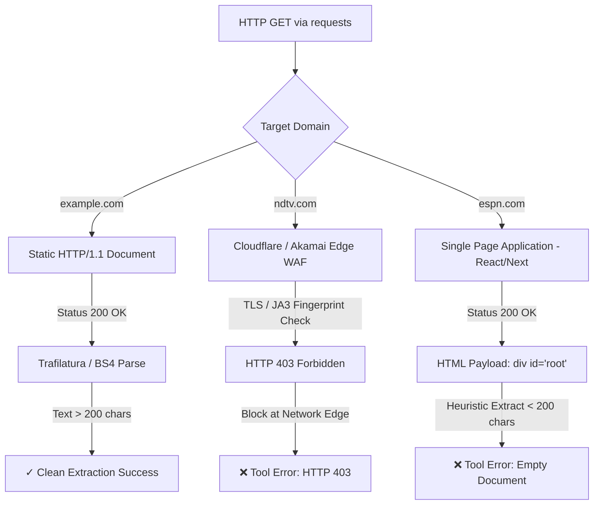
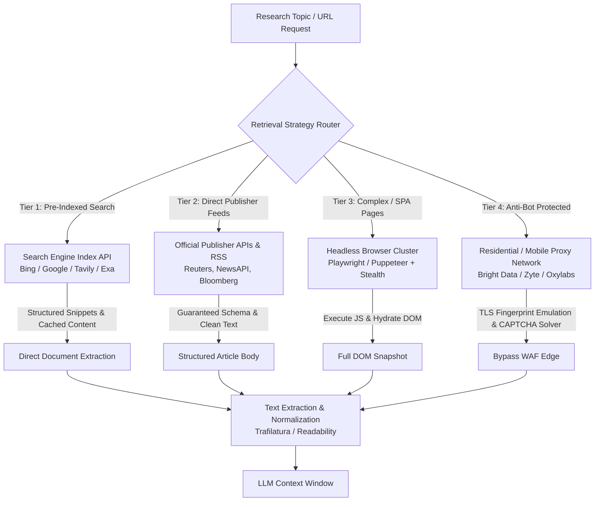
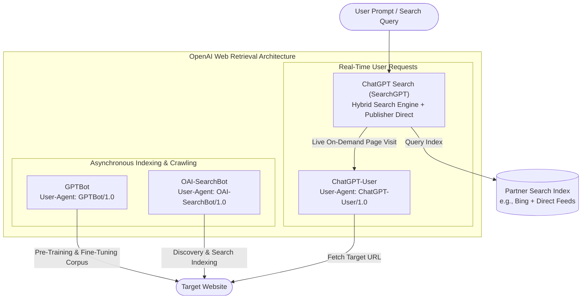

# Engineering Learnings, Debugging & Web Retrieval Analysis

This document provides a technical post-mortem, debugging log, and architectural comparative analysis of the **Multi-Agent Research System**. It details real-world challenges encountered during development—with special focus on web scraping limitations, anti-bot mechanisms, fault tolerance, and enterprise retrieval architectures.

---

## 1. Project Implementation & Limitations Matrix

To maintain rigorous engineering honesty, the table below explicitly separates what has been implemented and tested from the encountered problems, applied mitigations, and unresolved technical boundaries.

| Component / Subsystem | What Was Actually Implemented | Problem Encountered | Solution Applied | Unresolved Limitations | Proposed Future Improvement |
| :--- | :--- | :--- | :--- | :--- | :--- |
| **Search Subsystem** | Tavily Search API wrapper (`web_search` tool) retrieving 5 ranked SERP results. | Queries occasionally returned high-level summaries without granular data. | Bound Tavily search to an autonomous ReAct agent to allow autonomous query formulation. | Dependent on Tavily API rate limits and external index freshness. | Implement query decomposition (generating 3 parallel sub-queries per topic). |
| **Web Scraping Subsystem** | 3-tier cascade (`scrape_url`): Trafilatura $\to$ Readability-lxml $\to$ BeautifulSoup4. | Edge WAF 403 Forbidden errors (NDTV) and empty DOMs from JS-rendered SPAs (ESPN). | Added spoofed Chrome 124 headers and 3-tier fallback to extract maximum static text. | Cannot execute JavaScript; cannot bypass modern edge WAFs (Cloudflare/Akamai). | Add headless browser automation fallback (Playwright) and search index fallback. |
| **Agent Orchestration** | 2 ReAct Agents (`create_agent`) + 2 LCEL Chains (`writer_chain`, `critic_chain`). | Gemini LLM calls experienced high latency (15–40s), causing the terminal to appear frozen. | Integrated rich terminal telemetry with timestamps, stage indicators, and tool logs. | Pipeline runs synchronously; Reader Agent inspects URLs sequentially. | Migrate to LangGraph for cyclic execution, parallel scraping, and async execution. |
| **State Management** | Central in-memory Python dictionary (`state: dict`) passed through pipeline steps. | State is transient; if an unhandled error occurred in Step 4, previous steps were lost. | Implemented safe tool exception handling returning error strings instead of crashing. | No persistence across process restarts or hardware crashes. | Add SQLite or Redis state checkpointing via LangGraph Checkpointer. |
| **Report Generation & Critique** | LCEL chains with strict system personas, structured sections, and 10-point scoring. | Initial outputs suffered from vague generalizations without citations. | Grounded the writer prompt strictly in `{research}` and enforced a dedicated "Sources" section. | Critic evaluation is purely informational; does not automatically trigger report revision. | Implement a reflection loop where low critique scores ($<7/10$) trigger automated rewrites. |

---

## 2. Deep Dive: The Web Scraping Challenge

Web scraping in automated LLM pipelines is notoriously brittle. While simple HTML pages extract seamlessly, production news outlets and media platforms employ sophisticated infrastructure to protect their content.

During empirical testing of our 3-tier scraper (`Requests` + `Trafilatura` + `Readability` + `BeautifulSoup`), we observed three distinct behaviors across target websites:



---

### Case 1: `example.com` — Why It Worked
- **HTTP Status**: `200 OK`
- **Result**: Immediate, clean text extraction.
- **Root Cause Analysis**:
  `example.com` is a standards-compliant, completely static HTML page maintained by IANA. 
  1. It requires zero client-side JavaScript execution to render text.
  2. It has no Web Application Firewall (WAF), rate-limiting middleware, or anti-bot heuristics.
  3. The entire document body is delivered in the initial TCP/TLS packet stream. Trafilatura and BeautifulSoup parsed the DOM tree without impedance.

---

### Case 2: NDTV — The HTTP 403 Forbidden Failure
- **HTTP Status**: `403 Forbidden`
- **Result**: Extraction failed at the transport layer (`requests.exceptions.HTTPError`).
- **Root Cause Analysis**:
  Despite adding browser-like headers in our implementation:
  ```python
  headers = {
      "User-Agent": "Mozilla/5.0 (Windows NT 10.0; Win64; x64) AppleWebKit/537.36 ... Chrome/124.0 Safari/537.36",
      "Accept-Language": "en-US,en;q=0.9",
      "Referer": "https://www.google.com/",
  }
  ```
  NDTV sits behind an enterprise Web Application Firewall (Cloudflare/Akamai). Modern WAFs do not rely solely on the `User-Agent` string to identify bots. They analyze:
  1. **TLS / JA3/JA4 Fingerprinting**: When Python's `requests` (via `urllib3` and `OpenSSL`) negotiates a TLS handshake, the cipher suites offered, client extensions, elliptic curves, and signature algorithms generate a signature distinctly different from Google Chrome's BoringSSL engine. The WAF classifies the connection as an automated script before any HTTP headers are evaluated.
  2. **HTTP/2 Pseudo-Header Ordering**: Real browsers negotiate HTTP/2 via ALPN and emit pseudo-headers (`:method`, `:authority`, `:scheme`, `:path`) in a strict sequence. Python `requests` defaults to HTTP/1.1, triggering bot heuristics.
  3. **IP Range & ASN Reputation**: Outgoing requests originating from standard residential VPNs, commercial datacenters, or cloud host providers receive a high risk score, resulting in an immediate 403 challenge or Cloudflare Turnstile block.

---

### Case 3: ESPN — The Empty-Document / Length Failure
- **HTTP Status**: `200 OK`
- **Result**: Trafilatura returned `None`; Readability returned boilerplate; final text was $<200$ characters, triggering `"Could not extract meaningful content from the page."`
- **Root Cause Analysis**:
  Unlike NDTV, ESPN did not block the HTTP request. Instead, the failure was architectural:
  1. **Client-Side Rendering (CSR)**: ESPN operates as a modern Single Page Application (SPA) built on React/Next.js. The raw HTML response returned by `requests.get()` is merely an empty document shell containing metadata, CSS links, and script tags:
     ```html
     <!DOCTYPE html>
     <html>
       <head><title>ESPN Article</title></head>
       <body>
         <div id="root"></div>
         <script src="https://cdn.espn.com/bundle.182fa.js"></script>
       </body>
     </html>
     ```
  2. **Absence of a JavaScript Engine**: Python's `requests` library is purely an HTTP transport client; it does not bundle a JavaScript runtime (such as Google V8). Consequently, the client-side hydration scripts never execute, the internal content APIs are never queried, and the `<div id="root">` element remains empty.
  3. **Heuristic Failure**: Both Trafilatura and Readability evaluate text-to-tag ratios and paragraph densities. Because the raw DOM contains only script tags and no `<p>` or article text, extraction fails the 200-character threshold.

---

## 3. How Production Research Systems Solve Web Retrieval

Production AI platforms (Perplexity AI, You.com, Google Gemini Grounding, Microsoft Copilot) do not rely on ad-hoc HTTP scraping scripts. Instead, they use a multi-layered retrieval infrastructure:



### Architectural Comparison of Retrieval Strategies

| Strategy | Mechanism | Key Strengths | Limitations & Costs |
| :--- | :--- | :--- | :--- |
| **Search Engine Indexes** *(Tavily, Bing, Exa, Google)* | Query pre-indexed, continuously crawled web caches. | Sub-second latency, zero scraping overhead, clean text snippets. | Requires API subscription; does not grant access to unindexed or paywalled URLs. |
| **Official Publisher APIs** *(NewsAPI, Bloomberg, Reuters)* | Direct REST/JSON interfaces provided by media organizations. | $100\%$ reliable, zero WAF blocks, legal compliance, rich metadata. | Expensive commercial licensing; restricted to participating publishers. |
| **RSS / Atom Feeds** *(Publisher RSS, Google News RSS)* | Syndicated XML feeds containing recent article bodies. | Bypasses client-side rendering; standard XML format; low server load. | Usually limited to recent headlines and excerpts; rarely contains full archives. |
| **Headless Browsers** *(Playwright, Puppeteer)* | Full Chromium instances executing JavaScript and rendering SPAs. | Renders dynamic content (ESPN), handles cookies, mimics real user interactions. | High CPU/RAM consumption; slow ($3\text{--}8$s per page); vulnerable to advanced bot detection. |
| **Managed Proxy Networks** *(Bright Data, Zyte, Oxylabs)* | Distributed residential IP routing with automated TLS spoofing. | Bypasses Cloudflare/Akamai WAFs, solves CAPTCHAs, global geo-targeting. | High cost per gigabyte; latency introduced by proxy hops. |
| **Web Archives / Bulk Datasets** *(Common Crawl, Wayback Machine)* | Terabytes of pre-crawled WARC files. | Free, massive historical depth, ideal for offline training. | Significant crawl lag (weeks to months); cannot serve real-time breaking news. |

---

## 4. ChatGPT's Web Retrieval Architecture

Based on OpenAI's official technical disclosures and published documentation, ChatGPT does not use a single monolithic web retrieval script. Instead, its web capabilities are split into **four distinct entities**, each with dedicated responsibilities, User-Agent identifiers, and `robots.txt` policies.



### 4.1 The Four Web Entities

#### 1. `GPTBot`
- **User-Agent Token**: `GPTBot` (e.g., `Mozilla/5.0 AppleWebKit/537.36 ... GPTBot/1.X`)
- **Purpose**: Asynchronous web crawling to collect large-scale corpora for training future foundation models (e.g., GPT-4, GPT-5).
- **Behavior**: Operates entirely in the background. It does *not* execute in response to user chat queries. It strictly adheres to `robots.txt` disallows for `User-agent: GPTBot` and observes standard crawl delays.

#### 2. `ChatGPT-User`
- **User-Agent Token**: `ChatGPT-User` (e.g., `Mozilla/5.0 ... ChatGPT-User/1.0`)
- **Purpose**: Real-time, user-directed web browsing.
- **Behavior**: Triggered only when a user prompt requires real-time information or when a user pastes a specific URL into ChatGPT. It acts as an interactive proxy fetching the requested resource. Importantly, OpenAI does not use data retrieved by `ChatGPT-User` to train its generative models.

#### 3. `OAI-SearchBot`
- **User-Agent Token**: `OAI-SearchBot`
- **Purpose**: Search engine indexing specifically designed for ChatGPT Search (formerly SearchGPT).
- **Behavior**: Unlike `GPTBot` (which collects raw training data), `OAI-SearchBot` discovers, indexes, and ranks web content so that it can be attributed, cited, and displayed as search results with source links inside the ChatGPT interface.

#### 4. `ChatGPT Search` (SearchGPT)
- **Architecture**: A hybrid retrieval-augmented generation engine that combines:
  1. High-throughput commercial search indexes (including Microsoft Bing).
  2. Direct content licensing agreements with major global publishers (e.g., Axel Springer, News Corp, Condé Nast, Financial Times, Dotdash Meredith, Le Monde).
  3. Real-time verification via `ChatGPT-User`.

---

### 4.2 Why ChatGPT's Capabilities Differ from `requests.get()`

A common question is why ChatGPT can browse websites that fail in a custom Python script:

1. **Search Index Integration vs. Cold Crawling**: ChatGPT rarely executes a cold `GET` request against an unknown server. It predominantly retrieves pre-cleaned, pre-indexed documents from large-scale search engine partners.
2. **Headless Execution Pipelines**: When executing real-time page inspection, ChatGPT's infrastructure uses sandboxed browser environments capable of evaluating JavaScript, resolving client-side DOM states, and handling responsive viewports.
3. **Publisher Partnerships & Direct Syndication**: For major news organizations that enforce strict paywalls or anti-bot defenses, OpenAI maintains bilateral commercial agreements allowing direct API access or IP whitelisting.
4. **Global IP Distribution**: Requests from `ChatGPT-User` originate from verified, globally distributed ASN blocks with high network trust scores, avoiding naive datacenter IP bans.
5. **Standards Compliance**: ChatGPT respects `robots.txt` directives, `noindex`, and `noarchive` tags. Websites that explicitly block `ChatGPT-User` will not be visited.

> [!IMPORTANT]
> **No System Can Access Every Website**: 
> It is an engineering myth that any retrieval system has universal access. Even ChatGPT Search cannot bypass hard consumer paywalls (such as Bloomberg or The Wall Street Journal for non-partnered queries), private corporate intranets, CAPTCHA challenges (Cloudflare Turnstile), or sites that disallow its user agents in `robots.txt`.

---

## 5. Agent Orchestration & Prompt Engineering Learnings

### 5.1 ReAct Loop Latency & Terminal Visibility
During initial testing with Google Gemini 3.8 Flash, invoking `search_agent.invoke(...)` and `reader_agent.invoke(...)` resulted in periods of 15 to 40 seconds where the terminal appeared unresponsive.

**Root Cause**:
In a ReAct agent loop, the model performs multiple reasoning cycles:
$$\text{Prompt} \longrightarrow \text{Thought} \longrightarrow \text{Tool Call} \longrightarrow \text{Observation} \longrightarrow \text{Final Synthesis}$$
Each Gemini inference hop requires network roundtrips, internal model reasoning, and generation tokens. 

**Engineering Solution**:
We implemented real-time terminal telemetry in [`src/pipelines/pipeline.py`](file:///c:/Users/sanja/Desktop/agentic%20ai/Langchain-Multi-Agent-Research-System/src/pipelines/pipeline.py) and [`src/tools/tools.py`](file:///c:/Users/sanja/Desktop/agentic%20ai/Langchain-Multi-Agent-Research-System/src/tools/tools.py):
- Printing immediate tool dispatch logs (`[Tool: web_search] Querying Tavily: '...'`).
- Logging extraction strategy transitions in `scrape_url`.
- Recording and printing wall-clock elapsed times for each pipeline stage.
- Utilizing `flush=True` on all console writes to bypass standard stdout stream buffering.

### 5.2 Grounding & Eliminating Hallucinations in the Writer Chain
Early prompt iterations allowed the model to introduce outside general knowledge into the report, resulting in uncited claims.

**Mitigation**:
We engineered the `writer_prompt` in [`src/agents/agents.py`](file:///c:/Users/sanja/Desktop/agentic%20ai/Langchain-Multi-Agent-Research-System/src/agents/agents.py#L40-L56) with strict grounding constraints:
```python
writer_prompt = ChatPromptTemplate.from_messages([
    ("system", "You are an expert research writer. Write clear, structured and insightful reports."),
    ("human", """Write a detailed research report on the topic below.

Topic: {topic}

Research Gathered:
{research}

Structure the report as:
- Introduction
- Key Findings (minimum 3 well-explained points)
- Conclusion
- Sources (list all URLs found in the research)

Be detailed, factual and professional."""),
])
```
By explicitly providing `{research}` (the concatenated search snippets and scraped full-text) and mandating a `Sources` section, Gemini is constrained to synthesize verified facts rather than generating unverified assertions.

### 5.3 Automated Evaluation via the Critic Chain
To create an objective feedback loop, the `critic_chain` evaluates the generated report against a standard editorial rubric. By using a strict output format (`Score: X/10`, `Strengths:`, `Areas to Improve:`, `One Line Verdict:`), the evaluation remains structured, readable, and machine-parseable.

### 5.4 Transport Resilience: Resolving httpx.RemoteProtocolError & Server Disconnects
During pipeline execution (specifically in Step 2, Reader Agent), the system encountered the following crash:
```
httpcore.RemoteProtocolError: Server disconnected without sending a response.
httpx.RemoteProtocolError: Server disconnected without sending a response.
```

**Root Cause**:
1. **Stale Pooled Keep-Alive Connections**: When `build_search_agent()` finishes in Step 1, the underlying HTTP client (`httpx` via `google.genai`) maintains an open TCP socket connection in its connection pool. If Google's edge load balancer terminates the idle keep-alive socket before Step 2 starts, or if a prolonged generation causes a socket drop, `httpx` attempts to reuse the closed socket, raising `httpcore.RemoteProtocolError`.
2. **SDK Retry Limitations**: While Google's `google.genai` SDK uses `tenacity`, its default retry policy only handles specific HTTP status codes (such as 429 or 503). It does *not* catch low-level transport exceptions like `RemoteProtocolError`, allowing them to bubble up and terminate the application.

**Engineering Solution**:
1. **Explicit Model Timeouts & Retries**: In [`src/agents/agents.py`](file:///c:/Users/sanja/Desktop/agentic%20ai/Langchain-Multi-Agent-Research-System/src/agents/agents.py), configured `ChatGoogleGenerativeAI(timeout=120, max_retries=5)`.
2. **Pipeline Exponential Backoff (`invoke_with_retry`)**: In [`src/pipelines/pipeline.py`](file:///c:/Users/sanja/Desktop/agentic%20ai/Langchain-Multi-Agent-Research-System/src/pipelines/pipeline.py), wrapped all agent and chain invocations in an exponential backoff retry handler (`max_retries=3`, initial delay of $2.0$s). If a transient disconnection occurs, the handler logs a warning, establishes a clean connection, and automatically retries without crashing the pipeline.

---

## 6. Future Architectural Roadmap

1. **Migration to LangGraph**:
   Replace the linear Python pipeline with a stateful LangGraph workflow:
   - Introduce conditional edges based on the Critic's score (e.g., if `score < 7`, loop back to the Writer Chain with critique feedback).
   - Add persistent state checkpointing (SQLite/PostgreSQL) to enable pause-and-resume execution.
2. **Headless Browser Fallback**:
   Integrate Playwright with `playwright-stealth` as a secondary fallback for URLs where Trafilatura returns $<200$ characters, enabling full client-side SPA rendering.
3. **Asynchronous Parallel Scraping**:
   Upgrade the Reader Agent to scrape candidate URLs concurrently using `asyncio` and `aiohttp`, reducing total pipeline execution time by up to $60\%$.
4. **Tavily Extract Endpoint Integration**:
   For URLs blocked by edge WAFs, leverage Tavily's managed extract API (`tavily.get_search_context`), which utilizes enterprise proxy pools to retrieve clean markdown.