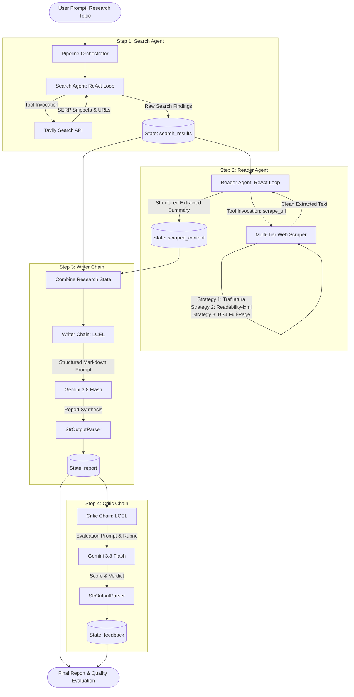

# Multi-Agent Research System

[](https://www.python.org/)
[](https://python.langchain.com/)
[](https://ai.google.dev/)
[](https://tavily.com/)
[](LICENSE)

An autonomous, multi-stage research and synthesis system built with **LangChain**, **Google Gemini 3.8 Flash**, and **Tavily**. The architecture orchestrates dynamic ReAct tool-calling agents and deterministic LCEL (LangChain Expression Language) chains to discover, scrape, synthesize, and evaluate comprehensive research reports on any subject.

---

## Architecture Overview

The system follows a sequential 4-stage pipeline combining autonomous tool-use agents with deterministic generation and evaluation chains:



---

## Key Features

- **Hybrid Agent-Chain Architecture**: Combines dynamic, non-deterministic ReAct agents (`create_agent`) for exploratory tasks (web search, selective link scraping) with deterministic LCEL pipelines (`writer_prompt | llm | StrOutputParser()`) for structured drafting and critique.
- **Deep Web Search**: Powered by the Tavily Search API to retrieve ranked, domain-filtered search snippets, titles, and authoritative URLs.
- **3-Tier Cascade Web Scraper**: Custom content extraction pipeline with fallback logic:
  1. *Trafilatura*: High-precision heuristic parser for editorial and blog content.
  2. *Readability-lxml + BeautifulSoup*: Fallback DOM density extractor stripping scripts, styles, forms, and navigation tags.
  3. *Full-Page BeautifulSoup*: Raw text normalization fallback for non-standard HTML layouts.
- **Automated Research Critique**: Implements an automated LLM reviewer acting as a strict editorial critic, scoring reports out of 10 and identifying strengths, weaknesses, and a final verdict.
- **Real-Time Terminal Telemetry**: Live stage-by-stage execution logging with timestamps, elapsed time calculations, and tool-level activity reporting to monitor slow LLM inference steps.
- **Shared In-Memory State**: Explicit data dictionary passed cleanly between pipeline stages without hidden global variables.

---

## Tech Stack

| Component | Technology | Role |
| :--- | :--- | :--- |
| **Language** | Python 3.11 | Core runtime environment |
| **Agent Framework** | LangChain Core / Community | Agent loops (`create_agent`), LCEL piping (`\|`), and tool abstractions |
| **Foundation Model** | Google Gemini 3.8 Flash | LLM reasoning, document extraction, report generation, and critique |
| **Search Engine API** | Tavily Python SDK | Targeted web search optimized for AI agent consumption |
| **Scraping & Parsing**| Trafilatura, Readability-lxml, BeautifulSoup4, Requests | Multi-strategy HTML content extraction and boilerplate elimination |
| **Terminal & Logging**| Rich, Datetime, Time | Stage timestamps, execution metrics, and color-coded console logs |

---

## Project Structure

```
Langchain-Multi-Agent-Research-System/
├── .env.example              # Sample environment configuration template
├── .gitignore                # Git ignore configuration
├── requirements.txt          # Python dependencies
├── main.py                   # Main CLI entrypoint
├── app.py                    # Streamlit application entrypoint (placeholder)
├── README.md                 # Project overview and quickstart
├── ARCHITECTURE.md           # System design, state machine, and data flow
├── LEARNINGS_AND_CHALLENGES.md # Web scraping post-mortem, bot mitigation, and research
└── src/
    ├── __init__.py
    ├── agents/
    │   ├── __init__.py
    │   └── agents.py         # Search Agent, Reader Agent, Writer Chain, Critic Chain
    ├── pipelines/
    │   ├── __init__.py
    │   └── pipeline.py       # Orchestration logic, state flow, and telemetry
    └── tools/
        ├── __init__.py
        └── tools.py          # Tavily search tool and 3-tier cascade web scraper
```

---

## Setup & Installation

### 1. Prerequisites
- Python 3.11 installed
- A Google Gemini API key ([Google AI Studio](https://aistudio.google.com/))
- A Tavily API key ([Tavily AI](https://tavily.com/))

### 2. Clone the Repository
```bash
git clone https://github.com/your-username/Langchain-Multi-Agent-Research-System.git
cd Langchain-Multi-Agent-Research-System
```

### 3. Environment Setup

Using Conda (Recommended):
```bash
conda create -n multiagent python=3.11 -y
conda activate multiagent
python -m pip install -r requirements.txt
```

Or using standard `venv`:
```bash
python -m venv .venv
# On Windows:
.venv\Scripts\activate
# On Linux/macOS:
source .venv/bin/activate
pip install -r requirements.txt
```

### 4. Configure Environment Variables
Create a `.env` file in the project root based on `.env.example`:
```bash
cp .env.example .env
```
Populate `.env` with your API keys:
```env
GOOGLE_API_KEY="AIzaSyYourGeminiAPIKeyHere"
TAVILY_API_KEY="tvly-YourTavilyAPIKeyHere"
```

---

## Execution

To execute the research pipeline from the terminal:

```bash
python main.py
```

### Real-Time Terminal Telemetry Preview

The pipeline outputs live progress tracking at every stage, so you know exactly what is happening while Gemini processes each task:

```
============================================================
🚀 Multi-Agent Research System Starting
📋 Topic: impact of AI on the job market in 2026
🕒 Timestamp: 2026-11-02 02:30:00
============================================================

============================================================
[02:30:00] Step 1/4 - Search Agent is working...
⏳ Invoking Gemini to plan research queries & retrieve sources via Tavily...
============================================================
  [Tool: web_search] Querying Tavily: 'impact of AI on the job market in 2026'...
  [Tool: web_search] Retrieved 5 results.

[02:30:14] ✓ Step 1 Completed (14.20s)
📄 Search Results Preview:
Title: The AI Labor Market Shift in 2026...

============================================================
[02:30:14] Step 2/4 - Reader Agent is working...
⏳ Invoking Gemini to analyze sources and scrape page content...
============================================================
  [Tool: scrape_url] Fetching URL: https://example-report.org/ai-workforce...
  [Tool: scrape_url] Strategy 1 (Trafilatura) succeeded (3420 chars extracted).

[02:30:35] ✓ Step 2 Completed (21.40s)
...
============================================================
🎉 Research Pipeline Finished Successfully in 58.70s
⏱️ Timing Breakdown: Search: 14.2s | Reader: 21.4s | Writer: 15.1s | Critic: 8.0s
============================================================
```

---

## Detailed Documentation

For a comprehensive technical exploration of this codebase:
- **[System Architecture & Data Flow (`ARCHITECTURE.md`)](ARCHITECTURE.md)**: Deep dive into state management, agent vs. chain paradigms, LangChain tool decorators, and error boundaries.
- **[Learnings, Challenges & Scraper Post-Mortem (`LEARNINGS_AND_CHALLENGES.md`)](LEARNINGS_AND_CHALLENGES.md)**: Real-world scraping failure analysis (NDTV 403, ESPN SPA blank documents), enterprise retrieval systems, and how ChatGPT's retrieval architecture (OAI-SearchBot, GPTBot, ChatGPT-User) works.

---

## License

This project is licensed under the MIT License - see the [LICENSE](LICENSE) file for details.

```

Or using standard `venv`:
```bash
python -m venv .venv
# On Windows:
.venv\Scripts\activate
# On Linux/macOS:
source .venv/bin/activate
pip install -r requirements.txt
```

### 4. Configure Environment Variables
Create a `.env` file in the project root based on `.env.example`:
```bash
cp .env.example .env
```
Populate `.env` with your API keys:
```env
GOOGLE_API_KEY="AIzaSyYourGeminiAPIKeyHere"
TAVILY_API_KEY="tvly-YourTavilyAPIKeyHere"
```

---

## Execution

To execute the research pipeline from the terminal:

```bash
python main.py
```

### Real-Time Terminal Telemetry Preview

The pipeline outputs live progress tracking at every stage, so you know exactly what is happening while Gemini processes each task:

```
============================================================
🚀 Multi-Agent Research System Starting
📋 Topic: impact of AI on the job market in 2026
🕒 Timestamp: 2026-11-02 02:30:00
============================================================

============================================================
[02:30:00] Step 1/4 - Search Agent is working...
⏳ Invoking Gemini to plan research queries & retrieve sources via Tavily...
============================================================
  [Tool: web_search] Querying Tavily: 'impact of AI on the job market in 2026'...
  [Tool: web_search] Retrieved 5 results.

[02:30:14] ✓ Step 1 Completed (14.20s)
📄 Search Results Preview:
Title: The AI Labor Market Shift in 2026...

============================================================
[02:30:14] Step 2/4 - Reader Agent is working...
⏳ Invoking Gemini to analyze sources and scrape page content...
============================================================
  [Tool: scrape_url] Fetching URL: https://example-report.org/ai-workforce...
  [Tool: scrape_url] Strategy 1 (Trafilatura) succeeded (3420 chars extracted).

[02:30:35] ✓ Step 2 Completed (21.40s)
...
============================================================
🎉 Research Pipeline Finished Successfully in 58.70s
⏱️ Timing Breakdown: Search: 14.2s | Reader: 21.4s | Writer: 15.1s | Critic: 8.0s
============================================================
```

---

## Detailed Documentation

For a comprehensive technical exploration of this codebase:
- **[System Architecture & Data Flow (`ARCHITECTURE.md`)](ARCHITECTURE.md)**: Deep dive into state management, agent vs. chain paradigms, LangChain tool decorators, and error boundaries.
- **[Learnings, Challenges & Scraper Post-Mortem (`LEARNINGS_AND_CHALLENGES.md`)](LEARNINGS_AND_CHALLENGES.md)**: Real-world scraping failure analysis (NDTV 403, ESPN SPA blank documents), enterprise retrieval systems, and how ChatGPT's retrieval architecture (OAI-SearchBot, GPTBot, ChatGPT-User) works.

---

## License

This project is licensed under the MIT License - see the [LICENSE](LICENSE) file for details.